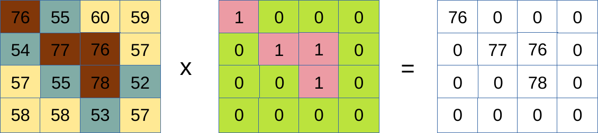

## Vorlesung

<embed src="slides/02b_Rasterbasics.pdf" type="application/pdf" width="100%" height="500">

### Das Rasterdatenmodell

Nachdem wir uns in der letzten Einheit mit diskreten Objekten beschäftigt haben, die wir über das Vektordatenmodell beschreiben, kommen wir diese Woche zum Rasterdatenmodell. Während das Vektormodell die Welt als einzelne Objekte (Punkte, Linien, Polygone) modelliert, repräsentiert das Rastermodell die Erdoberfläche als eine kontinuierliche Fläche.

Ein Rastermodell unterteilt den Raum über Zeilen und Spalten in ein gleichmäßiges Gitter aus Zellen (Pixeln). Jede dieser Zellen enthält einen einzigen Wert, der eine bestimmte Eigenschaft dieses Pixels beschreibt. Das Rastermodell ist ideal für Phänomene, die keine scharfen Grenzen haben, sondern fließend ineinander übergehen. Man spricht hier von kontinuierlichen Feldern, auch wenn sowohl kontinuierliche Informationen (z. B. Temperatur oder Geländehöhe) als auch diskrete Informationen (z. B. Landnutzungsklassen) abgespeichert werden können. 

### Rasterdatenverarbeitung

Bei der Rasterdatenverarbeitung werden die numerischen Werte einzelner Pixel (Zellen) genutzt, um neue Informationen abzuleiten. Die gängigsten Verfahren lassen sich in folgende Kategorien einteilen:

- Mathematische Operationen (Raster-Algebra): Das wichtigste Werkzeug ist sicherlich der Rasterrechner, mit dem sich Raster miteinander verrechnen und das Ergebnis in einem neuen Raster speichern lassen. Da das Datenmodell pro Pixel einen numerischen Wert vorsieht, können wir ganze Raster entweder mit einzelnen festen Werten verrechnen (z. B. Raster * 100) oder mehrere Raster miteinander kombinieren, wie die Abbildung zeigt. Technisch lässt sich das in QGIS über den Rasterrechner umsetzen. Es können auch Wertebereiche zusammengefasst werden (z.B. Alles unter 1000 -> 1 alles über 1000 > 2). In QGIS ist das über Werkzeuge wie "Nach Tabelle neuklassifizieren" möglich.

{#fig-intersections width="80%"}

- Reklassifizierung: Hierbei werden bestehende kontinuierliche Werte in neue, diskrete Klassen überführt. Zum Beispiel kann eine Höhenkarte in Risikozonen (niedrig, mittel, hoch) eingeteilt werden. Das entsprechende QGIS Werkzeug ist "Nach Tabelle neuklassifizieren".

- Resampling: Hierbei wird die räumliche Auflösung eines Rasters verändert, um es an andere Datensätze anzupassen oder die Daten zu aggregieren. Dies ist oft nötig, wenn Raster mit unterschiedlichen Pixelgrößen kombiniert werden sollen. Gängige Methoden sind die nächste-Nachbar-Zuordnung (Nearest Neighbor), oder bilineare Interpolation. Resampling wird auch bei Reprojektionen oder zur Reduzierung der Datenmenge eingesetzt.

- Filterung und Nachbarschaftsoperationen (Fokale Statistik): Diese Werkzeuge beziehen über ein Moving-Window-Verfahren die Umgebung eines Pixels in die Berechnung ein. Dabei wählen wir selbst die Größe des Fensters bzw. Filters und bestimmen so, wie groß die berücksichtigte Nachbarschaft ist (z. B. 3x3- oder 5x5-Filter). Die angewendete Funktion beschreibt, wie die Werte in diesem Fenster zusammengefasst werden sollen. Mit einem Mittelwert-Filter lassen sich lokale Unterschiede zusammenfassen (dient auch zur Glättung von Daten), während Maximum- oder Minimum-Filter zur Kantenerkennung dienen. Interessant sind auch Filter, die die Variabilität der Daten beschreiben: Über die Berechnung von Varianz oder Standardabweichung lässt sich die Heterogenität der Landschaft beschreiben. In QGIS kann dafür am Besten auf das Werkzeug aus GRASS GIS zurückgegriffen werden:  "r.neighbors".

- Distanzberechnungen (rasterbasierte Entfernungsanalyse): Hierbei wird für jedes Pixel eines Rasters die Entfernung zu bestimmten Objekten berechnet – zum Beispiel zu Straßen, Gewässern oder Punkten. Das Ergebnis ist ein Distanzraster, das direkt ablesen lässt, wie weit jeder Ort vom nächsten Objekt entfernt ist. Die Berechnung erfolgt in der Regel als euklidische Distanz (Luftlinie) und lässt sich in QGIS beispielsweise über das Werkzeug „Proximity“ bzw Nähe (Rasterabstand) umsetzen. Beispiel: Distanz zu Wasserflächen.

## Übung

Für die Übungen, ladet das digitale Geländemodell (https://uni-muenster.sciebo.de/s/pWKY2YAMKBgjxZD) und das digitale Oberflächenmodell (https://uni-muenster.sciebo.de/s/mrmkojzc9NSDSm6) von Münster. 

:::{.callout-tip}
## Aufgabe:

1. Binäre Klassifikation der Geländehöhe: 
Erstelle ein binäres Raster, das Geländehöhen unter 50 m als „niedrig“ und alle Werte ab 50 m als „hoch“ klassifiziert. Da das Rastermodell nur numerische Werte speichern kann, kodiere die Klassen wie folgt: niedrig = 1; hoch = 2.
Speichere den resultierenden Datensatz als neues Raster ab. 

2. Berechnung der Vegetationshöhe: Berechne die Vegetationshöhe aus der Differenz zwischen Oberflächenhöhe und Geländehöhe.

3. Heterogenität der Vegetationshöhe: Erstelle einen Layer, der die kleinräumige Heterogenität der Vegetationshöhe beschreibt. Dieser soll Bereiche hervorheben, in denen auf kurzer Distanz sowohl hohe als auch niedrige Vegetation vorkommt. Verwende dazu einen 3x3-Filter und ein Heterogenitätsmaß deiner Wahl (z. B. Standardabweichung oder Varianz). Tipp: Das Werkzeug ist in GrassGIS implementiert und über GIS verfügbar. Es heißt "r.neighbors"

:::

