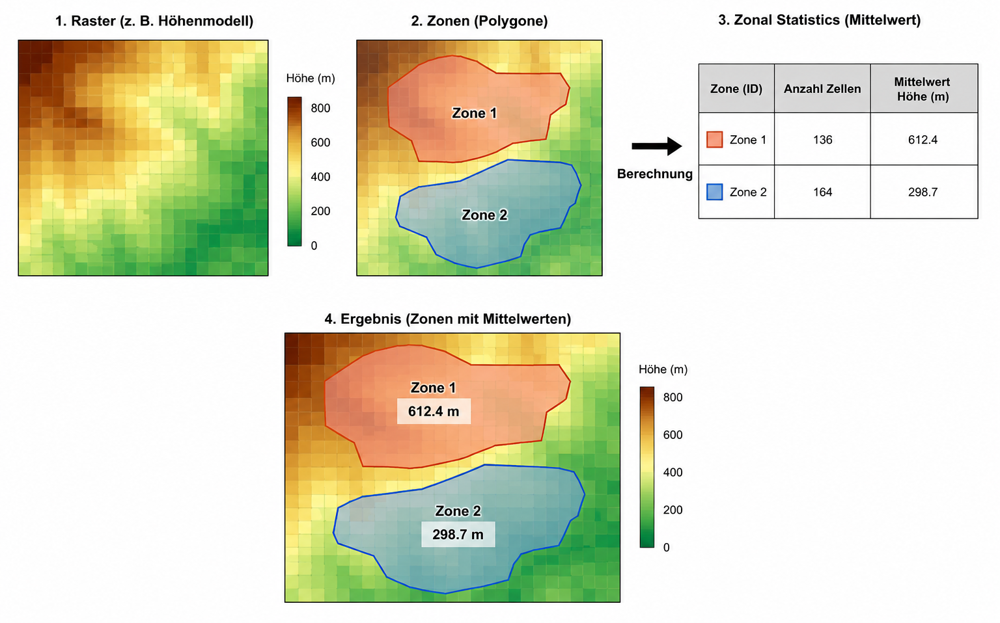

## Vorlesung

<embed src="slides/02c_Raster-Vector_basics.pdf" type="application/pdf" width="100%" height="500">

### Warum beide Datenmodelle kombinieren?
In den vorherigen Abschnitten haben wir die beiden grundlegenden Datenmodelle räumlicher Daten kennengelernt: Rasterdaten, die die Fläche in ein regelmäßiges Zellraster unterteilen und jedem Pixel einen numerischen Wert zuweisen (z. B. Höhen, Temperaturen, Vegetationsindizes), und Vektordaten, die räumliche Objekte als Punkte, Linien oder Polygone mit präziser Geometrie und Attributinformationen repräsentieren (z. B. Bäume, Straßen, Stadtgrenzen).

In der Praxis tritt jedoch häufig die Situation auf, dass wir beide Datenmodelle miteinander verknüpfen müssen. Wir wollen zum Beispiel wissen, wie hoch die Geländehöhe an bestimmten Messpunkten ist, oder wie sich die durchschnittliche Niederschlagsmenge in einzelnen Landkreisen verteilt. Genau hier setzt das Themenfeld der Raster-Vektor-Interaktionen an. Es umfasst alle Werkzeuge und Methoden, die es ermöglichen, Informationen zwischen beiden Datenmodellen auszutauschen, zu kombinieren und zu verschneiden.

### Raster-Vektor-Verarbeitung
Im folgenden Block werden wir einige der wichtigsten Raster-Vektor-Interaktionen genauer betrachten.

1. Ausschneiden und Maskieren (Clip, Crop, Mask)
- Mit Vektorpolygonen lassen sich Raster räumlich begrenzen:
Clip/Crop: Das Raster wird auf die Ausdehnung eines Vektorpolygons zugeschnitten. Alles außerhalb wird entfernt.

- Mask: Ein Vektorpolygon dient als Maske – nur die Pixel, die innerhalb des Polygons liegen, bleiben erhalten. Alle anderen Pixel werden auf „NoData“ gesetzt. So lässt sich z. B. ein Geländemodell auf Stadtgrenzen beschränken.

2. Extraktion und Zonale Statistik
Hier werden Rasterwerte mit Vektorobjekten verschnitten:

- Extract: Rasterwerte werden an bestimmten Vektorpunkten abgefragt (z. B. Höhenwerte an Messpunkten) oder für Vektorflächen extrahiert (z. B. alle Pixel innerhalb eines Landkreises).

- Zonale Statistik: Für jede Vektorfläche (Zone) wird eine zusammenfassende Statistik der Rasterwerte berechnet – etwa Mittelwert, Maximum, Minimum oder Standardabweichung (s. Abbildung). 

{#fig-intersections width="80%"}

3. Konvertierung zwischen Raster und Vektor
- Vektor → Raster: Vektordaten werden in ein Raster umgewandelt (Rasterisierung). Jede Zelle (mit nutzerdefinierter Größe) erhält den Wert des Vektorobjekts, das sie überdeckt – z. B. Landnutzungsklassen oder Straßennetz.

- Raster → Vektor: Rasterdaten werden in Vektordaten überführt. Kontinuierliche Raster werden in Flächen (Polygone) umgewandelt – etwa Höhenstufen oder Klassifikationsergebnisse; oder Rastermittelpunkte werden mit ihren Werten in Punkte umgewandelt.

## Übung

:::{.callout-tip}
## Aufgabe:
Wie hoch sind die Bäume im Baumkataster? Beachtet, dass die Bäume einen gewissen Kronendurchmesser haben (sagen wir mal 10m), der zunächst z.B. über einen Puffer berechnet werden muss.

Daten: 

- Vegetationshöhe (in der letzten Woche berechnet): https://uni-muenster.sciebo.de/s/aYexkeCfAzXN5cS
- Baumkataster: https://opendata.stadt-muenster.de/dataset/digitales-baumkataster-m%C3%BCnster/resource/096c4fc2-cfdb-4b9b-840f-da9e638e65ec

:::
